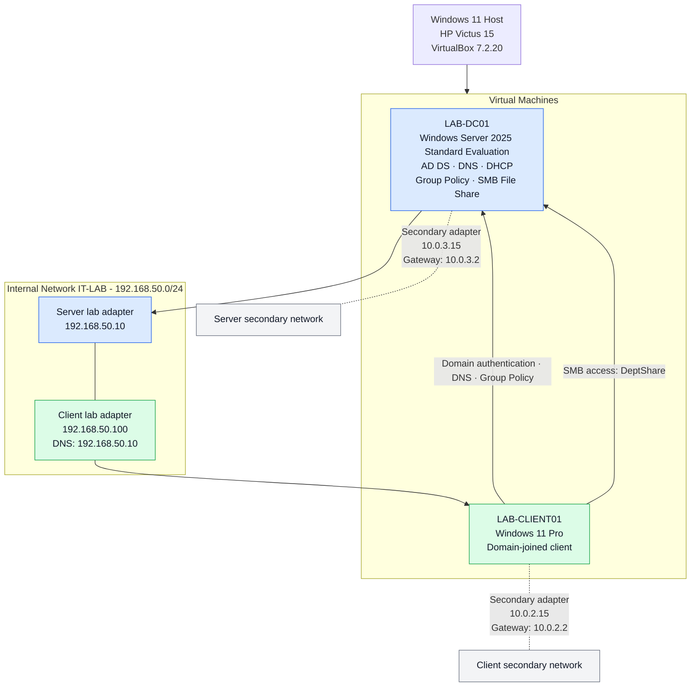

# IT Support & Troubleshooting Lab - Architecture

## Host environment

- Host OS: Windows 11
- Hardware: HP Victus 15, AMD Ryzen 5 5600H, 16 GB RAM
- Hypervisor: Oracle VirtualBox 7.2.20

## Architecture diagram

## Verified network details

| Component | Adapter | IPv4 address | Gateway |
|---|---|---|---|
| LAB-DC01 | Ethernet | 192.168.50.10 | None shown |
| LAB-DC01 | Ethernet 2 | 10.0.3.15 | 10.0.3.2 |
| LAB-CLIENT01 | Ethernet | 10.0.2.15 | 10.0.2.2 |
| LAB-CLIENT01 | Ethernet 2 | 192.168.50.100 | None shown |

The client lab adapter uses `192.168.50.10` for DNS. The server's lab adapter reports loopback DNS addresses (`::1` and `127.0.0.1`).

VirtualBox attachment modes have been verified: LAB-DC01 Adapter 1 uses Internal Network IT-LAB and Adapter 2 uses NAT. LAB-CLIENT01 Adapter 1 uses NAT and Adapter 2 uses Internal Network IT-LAB.

## Domain and services

- Active Directory domain: `ad.lab`
- Domain controller: `LAB-DC01`
- DHCP scope: `192.168.50.100`-`192.168.50.199`
- SMB share: `\\LAB-DC01\DeptShare`
- Client computer: `LAB-CLIENT01`

This diagram represents the observed lab configuration. It does not imply that the lab network has internet connectivity or a default gateway.

